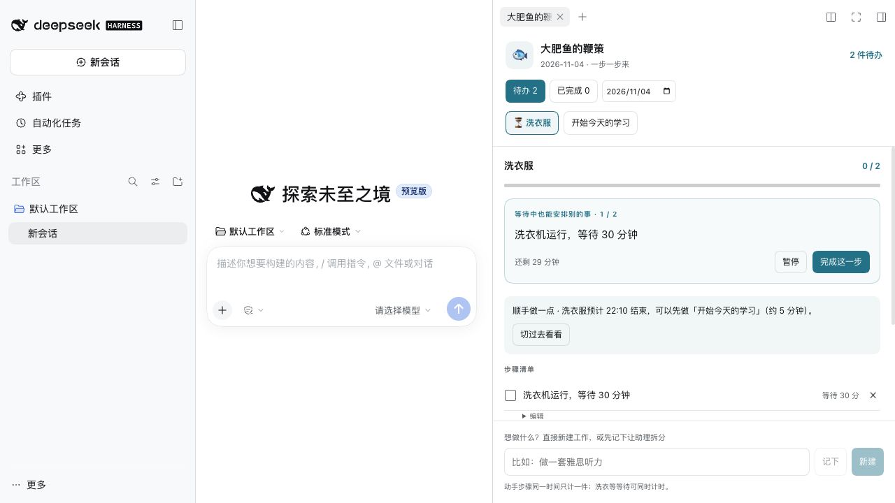

# 大肥鱼的鞭策 🐟 · DSH Todo Panel

**一个给 ADHD 用户在 DeepSeek Harness（DSH）里用、帮助克服工作启动困难的小插件。**

不是再列一张很长的清单，而是先回答：**我现在可以开始哪一个小步骤？**

它也适合容易拖延、面对大任务无从下手，或需要把等待时间安排得更顺一点的人。它是任务组织工具，不提供 ADHD 诊断或治疗。



*截图来自隔离演示环境，不含个人任务和聊天记录。*

## 它能做什么

- **眼前只突出一小步**：工作拆成具体的小动作，显示预计用时，点“开始”计时。
- **今天的工作今天看**：默认只显示当天待办；完成的工作收进“已完成”，历史可按日期查看。
- **工作选项卡**：在不同工作之间来回切换，即使只剩一件待办，也不会丢失返回入口。
- **自己动手改清单**：新建工作、添加和编辑步骤、修改用时，删除后还可以恢复。
- **两种计时**：需要动手的步骤同一时间只运行一件；洗衣、浸泡等等待步骤可以并行运行。切换选项卡不会改变计时。
- **顺手安排**：根据步骤顺序、剩余用时和等待空档，建议一件来得及完成的独立工作。
- **可选的助理提醒**：完成一步时夸一句、超时后轻轻催一下，等待期间提示可以先做哪件事。带冷却和去重，重启也不会清空提醒记录。

比如：洗衣机还要运行 30 分钟，而整理书桌只要 5 分钟，面板就能提示先整理书桌，再回来晾衣服。

## 兼容性

社区插件，非 DeepSeek 官方项目。已在 **DSH 0.2.1-rc.3 / macOS Apple Silicon** 上验证桌面冷启动和侧栏操作。DSH 的插件接口仍会变化，其他版本和操作系统需要自行验证。

日期筛选和时间显示当前采用 **Asia/Shanghai（北京时间）**。时间安排是根据用户填写用时计算的估算，不会自动替你完成步骤，也不会修改系统或 DSH 的独立闹钟。

## 安装

这个版本发布在 GitHub，尚未发布到 npm 或第三方插件市场。

1. 下载本仓库 ZIP 并解压，或运行：

   ```sh
   git clone https://github.com/lyle-alpha-sun/dsh-todo-panel.git
   ```

2. 等 DSH 正在执行的工作结束，正常退出桌面应用。
3. 使用 DSH 自带的命令安装本地目录；将路径换成你解压后的实际路径：

   ```sh
   dsh plugin --profile desktop add /absolute/path/to/dsh-todo-panel
   ```

4. 打开 DSH，在“插件 → 已安装”中启用 `dsh-todo-panel`。如果提示重启，重启后使用。
5. 右侧会出现“大肥鱼的鞭策”选项卡。首次使用是空清单，不会复制作者的个人任务。

没有 `dsh` 命令时，可先通过 DSH 应用菜单里的“管理 dsh 命令”配置命令入口。安装前建议备份自己的 profile 配置。

## 开始用

在底部填一件想做的事，点 **新建**，再展开 **添加步骤**。例如把“开始写作业”拆成“打开文档”“写一句标题”“写三条要点”。

- **记下**：先把想法存进 `待拆.md`，随后在 DSH 对话里请助理读取文件并帮你拆分。
- **新建**：直接创建一件工作，自己添加步骤。
- **步骤类型**：动手步骤选“需要动手”；机器运行、浸泡等选“等待 · 可并行”。对已有文本会尝试识别等待含义，可手动纠正。
- **工作安排**：调整工作先后顺序或安排日期。
- **时间安排**：查看估算的执行顺序、等待空档和收尾时间。
- **已移除**：恢复误删步骤。删除正在计时的步骤会停止该步骤的插件计时；恢复不会自动重启它。

“记下”只负责保存想法；复杂任务的自动拆分需要你在 DSH 中调用助理。时间规划本身在本机计算，不调用模型。

## 数据存在哪里

默认存放在你的 DSH 数据目录：

```text
$DSH_HOME/todo-panel/tasks.json
$DSH_HOME/todo-panel/待拆.md
$DSH_HOME/todo-panel/.todo-reminders.json
```

未设置 `DSH_HOME` 时，使用 `~/.dsh`。宿主端可通过 `config.dataFile` 指定其他位置，支持 `~/`。文件采用本地 JSON，助理和面板共用同一份数据；面板约每 4 秒读取一次更新。

## 可选：开启助理消息

公开版默认 `notify: false`，无需 API Key 即可使用面板、计时和本地时间估算。

希望收到助理的夸奖、催办或并行建议时，在你的 desktop profile 的 `cordis.patch.yml` 中添加：

```yaml
- id: dsh-todo-panel
  config:
    notify: true
    notifySession: YOUR_SESSION_ID
    nudgeCooldownMs: 2700000 # 同一步骤 45 分钟内不重复催办
```

将 `YOUR_SESSION_ID` 换成自己的目标会话 ID，并保持该会话已在 DSH 中打开。若未填写 `notifySession`，插件会尝试使用已安装心跳插件的提醒会话绑定；心跳插件不是必需依赖。

开启后会通过 DSH 的目标助理会话发起请求：相关任务文字会进入该会话的模型上下文，并可能产生你的模型服务费用。任务保存与提醒发送分别处理，提醒失败不会撤销已经保存的勾选结果。

提醒检查间隔约 15 秒；计时超时后由下一次检查发现。等待结束和同一等待期间的并行建议也会去重。DSH 退出期间插件不会运行，重新打开后会按保留的时间计算进度。

## 开发与检查

只使用 Node.js 标准库，运行依赖由 DSH 提供，无需安装额外前端依赖。

```sh
npm run build
npm run check
npm test
npm pack --dry-run
```

`lib/model.js` 包含纯日期和规划逻辑；构建脚本把同一份逻辑同步进浏览器模块。检查覆盖并发保存、勾选与撤销、元数据保留、日期过滤、等待与动手并行、步骤删除恢复、提醒发送失败、提醒去重和可移植路径。

## License

[MIT](LICENSE) · lyle-alpha-sun
